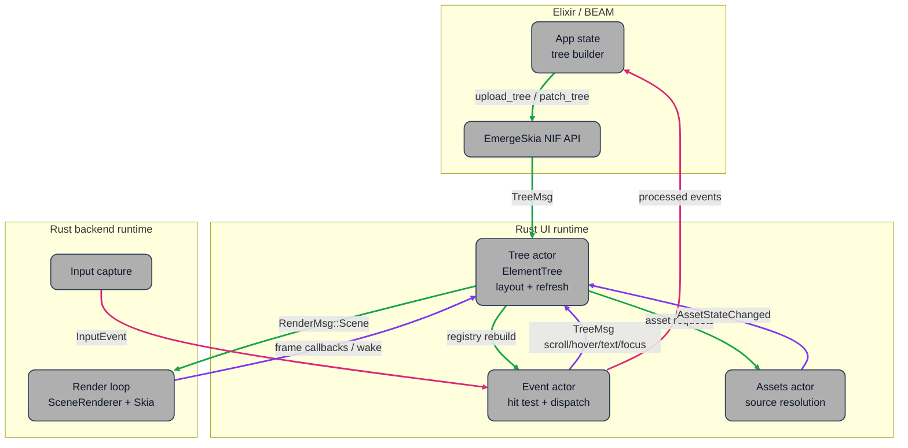

# Architecture

EmergeSkia is the native renderer, layout engine, event system, and backend
runtime used by Emerge. Elixir owns application state and encodes UI trees into
EMRG. Rust owns the decoded tree, layout, render-scene construction, event
hit-testing metadata, assets, text editing state, and backend rendering.

For the **current retained binary headless and Wayland** implementation, see
[edit, layout, draw and presentation owners](layout-refresh-render-flow.md#current-retained-path-binary-headless-and-wayland).
The `ElementTree`, registry/event actor, render queue and DRM descriptions below
refer to the reference renderer; they are not the retained session's threading model.

## Declarative configuration

Viewport mount returns `%Emerge.Config{}`; optional `config(previous)` or
`config(previous, state)` callbacks declare supported live updates. Previous is
normalized desired intent, independent of native accepted/applied revisions.
Configuration-only changes use bounded native control admission, not an empty
or synthetic tree upload. The lifecycle owner replays latest intent on recovery.
See [configuration](https://hexdocs.pm/emerge/Emerge.html#module-viewport-configuration) and
[config reconciliation](config-reconciliation.md).

DRM has a retained output/backlight owner and disposable internal presenters.
Off ignores native UI input and retires presenter resources, while preserving the
tree, ownership and requested settings. On creates a fresh presenter and requests
the latest tree; GPU resources are not restored. Explicit OpenGL, Vulkan and
raster (CPU or GPU-upload presentation) support power/brightness; automatic API
power remains guarded. GPU-upload raster reuses the OpenGL/GBM presenter, including
its retirement barriers. Resource readiness precedes application upload,
separately from first presentation.

## System Shape

The runtime is split into three ownership areas:

- Elixir/BEAM builds app state, uploads or patches EMRG trees, and receives
  processed UI events.
- Rust UI runtime owns `ElementTree`, layout/refresh, input registry, asset
  resolution, text editing, and animation sampling.
- Rust backend runtime owns window or framebuffer integration, Skia surfaces,
  render submission, native input capture, cursors, and IME integration.



## Runtime Threads

Windowed and DRM runs use long-lived native threads:

| Thread or actor | Owns | Communicates with |
|-----------------|------|-------------------|
| Tree actor | `TreeUpdateEngine`, `ElementTree`, retained outputs, last admitted registry, animation runtime | Event actor, render queue, assets actor, backend wake |
| Event actor | Event registry, hit testing, cursor decisions, scroll/text/focus dispatch | Tree actor and Elixir process |
| Backend render loop | Skia surface/context, `SceneRenderer`, renderer paint-layer cache; DRM presenter lifetime ends on off | Render queue and backend compositor/presenter |
| DRM power owner | Output lease, backlight binding/baseline, requested settings and presenter lifecycle | Independent bounded control lane, input gate and presenter wake |
| Backend input capture | Native pointer/keyboard/touch events | Event actor |
| Assets actor | Source path resolution and async asset state | Tree actor |
| Heartbeat/stats | Running state and optional renderer stats logging | Runtime resource |

`RenderSender` keeps only the latest pending render scene. If the bounded render
queue is full, an older scene can be dropped and pipeline timing metadata is
carried forward to the replacement scene.

`BackendWakeHandle` lets the tree and event actors request backend work without
knowing whether the backend is Wayland, DRM, macOS, raster, or a test no-op.

## Data Ownership

Elixir owns declared UI state. Rust owns runtime state derived from it.

`ElementTree` stores:

- stable node ids and topology
- declared attrs from EMRG patches/uploads
- `layout.effective`, the frame attrs used by layout and render
- layout frames, render frames, measured frames, scroll extents, and paragraph
  fragments
- runtime state for hover, mouse down, focus, text input, sliders, scrollbars,
  and nearby mounts
- layout caches, immutable owner paint/event records, a compiled flat registry,
  declared-resource bindings, and a touched-output journal

Render backends receive `RenderScene` values. They do not read or mutate
`ElementTree`.

## Tree Update Pipeline

The Rust tree actor receives `TreeMsg` batches. `TreeUpdateEngine` flattens the
batch, applies tree mutations, samples animations, prepares effective attrs, and
decides the cheapest valid output action.

```text
TreeMsg batch
  -> decode upload or patch
  -> apply input/runtime state
  -> join TreeInvalidation values
  -> prepare frame attrs when needed
  -> decide refresh action
     -> Skip
     -> RegistryUpdate
     -> RefreshOnly
     -> Recompute layout + refresh
```

The invalidation ladder is:

```text
None < Registry < Paint < Resolve < Measure < Structure
```

`Registry` and `Paint` can refresh without layout when a root frame exists.
`Resolve`, `Measure`, and `Structure` require layout recomputation.

The detailed traversal and cache behavior is documented in
[Layout, Refresh, Render, and Cache Flow](layout-refresh-render-flow.md).

## Layout and Refresh

Layout is organized as:

```text
prepare frame attrs
  -> measure
  -> resolve
  -> refresh
```

Frame attribute preparation copies declared attrs into `layout.effective`,
applies scale, overlays animation samples, applies interaction styles, and marks
layout/render/registry damage. Full preparation walks the flat tree; refresh-only
runtime and `SetAttrs` updates use the same preparation code on only the touched
ids plus active animation ids. Scroll-only refresh skips frame-attr preparation
when no animation is active because scroll state already lives in layout state;
with active animations it prepares only the active animation ids.

The layout passes are:

- Measure: bottom-up intrinsic and subtree measurement.
- Resolve: top-down final placement, scroll extents, render frames, transformed
  layout-aware bounds, and nearby geometry.

Refresh converts the laid-out tree into:

- a `RenderScene` for the renderer
- a complete flat registry when its compiled version changes or publication is requested
- IME metadata and text state
- an animation-active flag

Paint and events maintain independent owner records through the touched-output
journal. Ordinary and Nearby owners use the same mechanism. Registry changes are
compared with the last admitted output, not merely the last compiled candidate,
so failed-frame retries still publish. IME comes from compiled input state, not
paint side effects. Declared resource bindings are maintained from touched owners
and rebuilt on structural changes.

Owner-local commands, resolved composition properties and child ordering are
retained separately, including stable empty/culled consuming slots and batched
path-copy updates. Placement/opacity reuse command chunks; unchanged ancestors
reuse resolved properties. Paint derives coordinate/culling contexts without
building event interaction-clip chains. Paragraph inline decorations remain an
explicit culling/scope dependency.

Run facts are derived locally and content summaries fold prepared run/Shared
facts without materializing own-node views. Child layers contribute composition
counts/shadow flags, not parent raster bounds or primitive cost. Generation is
an internal content hash for payload keys, not a substitute for executable-input
equality. Installed order, prepared text geometry and actual image call arguments
are shared with the renderer. Composition rewrites preserve those argument scopes
without flattening unchanged command buffers.

Visible-frame reuse compares saved executable inputs before drawing. Explicit
invalidation clears that comparison; it is not a last-successful-frame protocol.
Scene/in-flight resource scopes own pixels and source records, while saved image
selectors retain weak headers and nonpixel dispatch data. See the
[flow and lifecycle contracts](layout-refresh-render-flow.md).

## Render Architecture

Render-scene construction is separate from Skia drawing:

```text
ElementTree
  -> tree/render.rs builds RenderScene
  -> backend render loop receives RenderMsg::Scene
  -> SceneRenderer traverses RenderNode tree
  -> Skia draw calls and paint-layer cache composition
  -> surface flush/present
```

`RenderScene` contains `RenderNode` values:

- primitive draw commands
- clip, relaxed clip, transform, alpha, and shadow-pass scopes
- paint layers

Paint layers are stable semantic composition boundaries: Root, Nearby,
ScrollContent, compositor Animation, SliderValue, and DirectMedia. Their ordered
content interleaves independently cacheable own-paint runs with semantic child
layers under shared clip, transform, alpha, and shadow scopes. Damage changes
payload generations; it does not change layer topology. Video remains direct.

Renderer cache behavior is backend-neutral:

- GPU backends store GPU image payloads.
- Raster paths can store CPU payloads.
- A cache miss or bypass falls back to direct drawing without changing output.

## Event Architecture

Backends normalize native input into `InputEvent` values. The event actor uses
the latest event registry to hit-test and dispatch:

- pointer move, enter/leave, press, release, click, and wheel
- scrollbar hover and drag
- drag-scroll
- focus and blur
- text input editing, selection, clipboard shortcuts, and IME commits
- slider updates
- key events and virtual keys

Event outcomes either go back to Elixir as processed UI events, to the tree
actor as `TreeMsg` runtime changes, or to the backend as cursor updates.

The event actor does not perform layout. It requests tree changes and consumes
registry rebuilds from the tree actor.

## Backends

Supported backend families:

| Backend | Purpose | Rendering path |
|---------|---------|----------------|
| Wayland | Windowed Linux runtime | OpenGL, raster presentation, or Vulkan with Wayland frame callbacks |
| DRM | Direct Linux framebuffer/kiosk runtime | OpenGL, raster GPU upload, or Vulkan with KMS presentation |
| macOS | Host runtime integration | Metal or raster through the native host protocol |
| Headless | Offscreen output | Retained frame binaries or Linux PRIME/DMA-BUF production |

Raster is a rendering API used with a backend, not a separate runtime backend.
Backends consume `RenderMsg::Scene`, update `RenderState`, and call
`SceneRenderer`. They also forward native input to the event actor and expose a
wake handle for redraws.

## Assets and Fonts

The asset pipeline resolves source-based images after upload or patch. Encoded
raster source records are retained separately from final decoded pixels. Drawing
computes fitted device-space dimensions and, when configured, decodes/resamples
to that target before inserting the final image into an entry/byte-bounded LRU.
The tree is notified with `AssetStateChanged` when source state changes.

Each native renderer owns:

- its asset source worker and source configuration
- registered font typefaces and text-metrics cache
- encoded image/vector source records
- bounded decoded-raster LRU
- bounded rendered-vector variant cache
- asset and font generations and diagnostic state

A retained decoded raster may outlive its encoded source record and render while
the source is restored asynchronously. Font and asset generations participate
in paint-layer payload keys so cached payloads are invalidated when contents
change. Renderer shutdown joins that renderer's worker and clears only its
asset state.

See [Assets and Images](assets-images.md) for source resolution, runtime path
security, and async loading behavior.

## Scaling Architecture

Elements keep declared attrs separate from frame-effective attrs:

- Declared attrs are stored from EMRG uploads and patches in unscaled form.
- `layout.effective` is rebuilt for the current frame and scale.

Scale is applied during frame attr preparation from the declared values, not by
mutating already-scaled output. This prevents cumulative scale errors.

Scaled fields include:

- pixel widths and heights, including min/max wrappers
- padding
- spacing
- border radius and border width
- font size
- font letter and word spacing
- transform/layout-scale dependent frame attrs

Render and event code read `layout.effective` and layout frames. They do not
perform their own high-DPI scaling.

## Retained Outputs and Cache Layers

Output records are authoritative state; renderer payload caching is separate:

| Cache | Owner | Scope |
|-------|-------|-------|
| Layout measure caches | `ElementTree` node layout state | Intrinsic and subtree measurement reuse |
| Layout resolve cache | `ElementTree` node layout state | Final frame and geometry reuse |
| Retained event contributions/order | `ElementTree` node refresh state | Affected-owner compilation and versioned flat output |
| Last admitted registry | `TreeUpdateEngine` | Publication identity, requests and acknowledgements |
| Retained paint/composition records | `ElementTree` node refresh state | Shared ordinary/Nearby scene snapshots; not raster boundaries |
| Declared-source index | `ElementTree` | Immutable source-binding snapshots and affected-owner updates |
| Renderer paint-layer payload cache | `SceneRenderer` | GPU/CPU own-run image reuse |
| Encoded asset/source status | Renderer asset runtime | Source resolution, generations, and async hydration |
| Decoded raster LRU | Renderer asset context | Entry/byte-bounded final pixel reuse |
| Rendered vector variants | Renderer asset context | Bounded SVG rasterization reuse |
| Font/text metrics caches | Renderer asset context | Typeface and text measurement reuse |

Each stage owns the state it can validate. Tree-side shared records do not create
GPU layers. Only the renderer decides whether a concrete own-run GPU/CPU image
payload should be stored or reused. Superseded Nearby fragment and registry chunk
caches have been removed.

## Module Structure

```text
native/emerge_skia/src/
  lib.rs                         NIF entry points, resource setup, runtime startup
  actors.rs                      Cross-actor message enums
  runtime/
    tree_actor.rs                Tree actor loop and render/event publication
    tree_update.rs               Batch processing and refresh decision
  tree/
    element.rs                   ElementTree, node state, dirty flags, caches
    attrs.rs                     Decoded attrs and style state
    deserialize.rs               EMRG decoder
    serialize.rs                 EMRG encoder used by tests/tools
    patch.rs                     Incremental tree patch application
    invalidation.rs              TreeInvalidation and refresh decision helpers
    animation.rs                 Animation runtime and frame samples
    layout.rs                    Frame attrs, measure, resolve, refresh
    render.rs                    ElementTree to RenderScene
    render/text.rs               Text render helpers
    scrollbar.rs                 Shared scrollbar geometry
  render_scene.rs                RenderScene, RenderNode, paint layers, primitives
  renderer.rs                    SceneRenderer, Skia drawing, renderer caches
  paint_layer_payload_cache.rs   Payload cache storage and eviction
  events.rs                      Event actor entry points and registry payloads
  events/
    registry_builder.rs          Event registry traversal and subtree cache
    scrollbar.rs                 Scrollbar hit and drag state
  assets.rs                      Asset actor and source resolution
  backend/
    wayland/                     Wayland OpenGL/Vulkan/raster presentation and input
    drm/                         Direct KMS with OpenGL/Vulkan/raster presentation
    headless/                    Binary and PRIME output
    vulkan/                      Shared Vulkan device/import helpers
    macos/                       macOS host protocol integration
    raster.rs                    Shared CPU renderer
    wake.rs                      Backend wake abstraction
    skia_gpu.rs                  Shared Skia GPU helpers
```

Elixir-side entry points:

```text
lib/emerge_skia.ex               Public API
lib/emerge_skia/native.ex        Rustler NIF bindings
```

## Related Guides

- [Layout, Refresh, Render, and Cache Flow](layout-refresh-render-flow.md)
- [Tree Patching](tree-patching.md)
- [EMRG Format](emrg-format.md)
- [Assets and Images](assets-images.md)
- [Events](events.md)
- [Nearby Semantics](nearby-semantics.md)
- [BEAM Performance Constraints](beam-performance-constraints.md)
